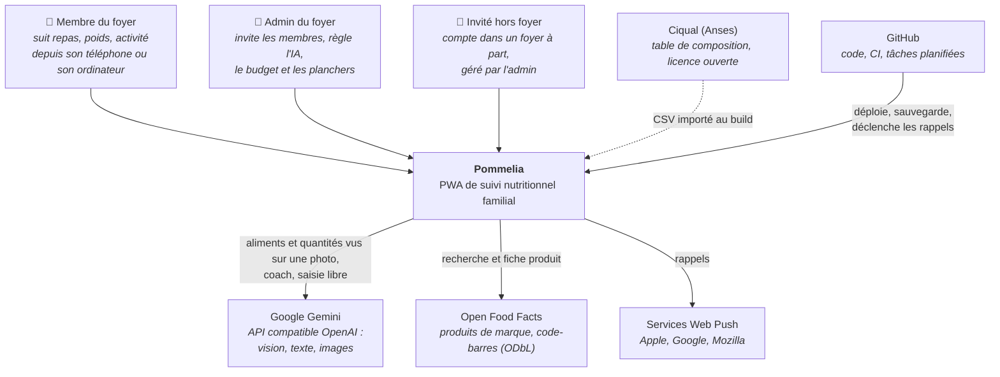
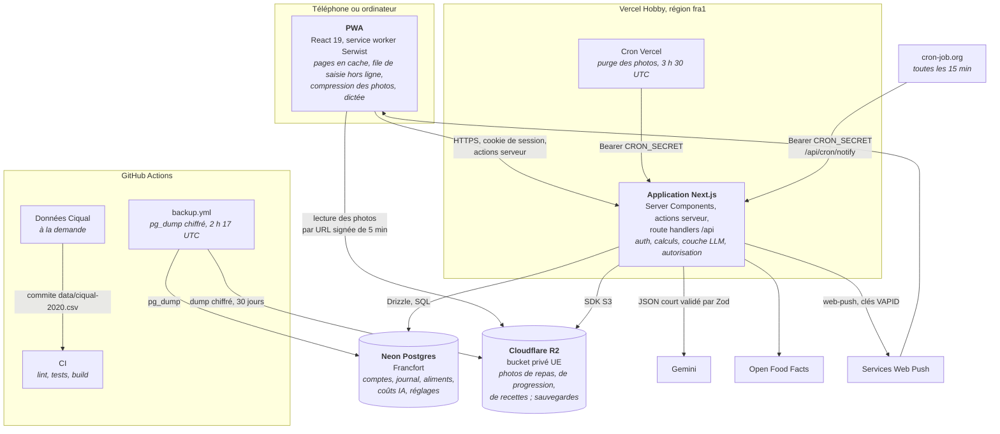

# Architecture — Pommelia

Ce document décrit l'application telle qu'elle tourne en production : les phases 0 à 15
de `docs/PLAN.md`, puis les évolutions faites après le plan (§7). Les choix
structurants et leurs raisons sont résumés dans `docs/DECISIONS.md` ; la mise en place,
les variables d'environnement et la restauration des sauvegardes sont dans `README.md`.

Mis à jour le 2026-10-10.

## 0. Vue d'ensemble (modèle C4)

Deux niveaux du modèle C4 suffisent pour une app de cette taille : le **contexte**
(qui utilise Pommelia et avec quels services elle parle) et les **conteneurs** (ce qui
tourne, où, et comment les morceaux communiquent). Le niveau composants est couvert par
l'arborescence (§2) et la couche LLM (§4).

### Niveau 1 : contexte



Le navigateur ne parle qu'à Pommelia : Gemini et Open Food Facts sont appelés côté
serveur (la CSP l'impose avec `connect-src 'self'`). La transcription de la voix se fait
dans le navigateur (Web Speech API), sans service payant.

### Niveau 2 : conteneurs



Chaque fusion sur `main` est déployée par l'intégration GitHub de Vercel ; `pnpm
vercel-build` applique les migrations Drizzle et met à jour la table Ciqual avant le
build. Localement, `docker compose up` remplace Vercel, Neon et R2 par l'app en
conteneur, un Postgres et RustFS (S3 local).

## 1. Stack et hébergement

| Couche | Choix |
|---|---|
| Langage | TypeScript strict (`strict`, `noUncheckedIndexedAccess`), Node.js 24 LTS, pnpm |
| Application | Next.js 16 (App Router), React 19, Server Components, actions serveur + Route Handlers, sortie `standalone` |
| Base | PostgreSQL 16 + Drizzle ORM / drizzle-kit, extensions `pg_trgm` et `unaccent` |
| Validation | Zod (entrées API, formulaires, sorties LLM) |
| Auth | Better Auth (bibliothèque) : email + mot de passe argon2, sessions en base, TOTP |
| UI | Tailwind CSS v4, composants maison (`src/ui`), design tokens en variables CSS, Fraunces (titres) et Plus Jakarta Sans auto-hébergées par `next/font` |
| i18n | next-intl, `fr` par défaut, `en` en second |
| PWA | Serwist (service worker) ; file de saisie hors ligne en `localStorage` (§ Finitions) |
| Photos | Stockage objet S3 (SDK AWS v3), bucket privé, URL signées de 5 min |
| Tests | Vitest (unitaires, intégration sur un vrai Postgres), Playwright (e2e) |
| Qualité | ESLint (+ jsx-a11y), Prettier, `tsc --noEmit` |
| CI/CD | GitHub Actions |

### Hébergement retenu : 0 €/mois hors LLM

Consigne d'Adel du 2026-10-02 : l'hébergeur le moins cher, l'UE n'est plus
obligatoire. Les trois offres gratuites ci-dessous gardent malgré tout les données
en UE, sans surcoût.

| Besoin | Service | Région | Coût | Limites qui comptent (vérifiées le 2026-10-02) |
|---|---|---|---|---|
| App + previews par PR | Vercel Hobby | fonctions en `fra1` (Francfort) | 0 € | Usage personnel non commercial ; 4 h de CPU actif / mois ; fonctions ≤ 300 s ; cron 1×/jour max |
| PostgreSQL | Neon Free | `aws-eu-central-1` (Francfort) | 0 € | 1 Go ; 100 CU-h / mois ; mise en veille après 5 min ; restauration sur 6 h seulement |
| Photos + sauvegardes | Cloudflare R2 | juridiction `eu` | 0 € | 10 Go ; 1 M écritures et 10 M lectures / mois ; sortie gratuite |
| Tâches planifiées | Vercel Cron (quotidien) + GitHub Actions `schedule` (plus fréquent) | — | 0 € | Minutes Actions gratuites depuis que le dépôt est public (2026-10-10) |

Compensations des limites :
- **Sauvegardes** : la restauration Neon gratuite ne couvre que 6 h. Un workflow
  GitHub Actions quotidien fait un `pg_dump` chiffré vers R2 (rétention 30 jours).
  La procédure de restauration est documentée en phase 15, testée dès la phase 0.
- **Cron fréquents** (rappels, v2) : un workflow Actions appelle toutes les 15 min
  une route `/api/cron/*` protégée par `CRON_SECRET`.
- **Portabilité** : le `Dockerfile` (sortie `standalone`) et `docker compose`
  (app + Postgres + RustFS, un S3 local) restent la référence locale ; changer pour un hébergeur
  à conteneurs (Scaleway, Fly, Render…) ne demande que de nouvelles variables d'env.
- **Si les quotas gratuits sont dépassés** : Vercel Pro (20 $/mois) ou bascule du
  conteneur chez Scaleway (≈ 5 à 10 €/mois). Le code ne change pas.

Environnements : local (`docker compose up`), preview par PR (Vercel, avec sa propre
branche de base Neon ; l'URL demande une connexion Vercel), production sur `main`
(`https://satia-delta.vercel.app` ; le domaine `pommelia.fr` est réservé chez OVH et
pointé vers Vercel, voir `docs/DECISIONS.md`).

## 2. Arborescence

```
satia/                      # le dépôt garde son nom d'origine
├── .github/workflows/
│   ├── ci.yml              # lint, format, typecheck, tests unitaires, intégration, e2e, build
│   ├── backup.yml          # pg_dump chiffré quotidien → R2
│   ├── ciqual-data.yml     # régénère data/ciqual-2020.csv depuis le XML officiel
│   └── docker.yml          # vérifie que l'image Docker se construit
├── docker-compose.yml      # app, postgres, rustfs (S3 local)
├── Dockerfile
├── vercel.json             # région fra1, commande de build, cron de purge
├── .env.example
├── data/                   # table Ciqual convertie (CSV)
├── drizzle/                # migrations SQL générées (0000 à 0021)
├── public/                 # icônes PWA, écrans de démarrage iOS, photos des recettes du catalogue
├── scripts/                # migrate, import-ciqual, import-recipes, ciqual/, icônes, bucket local
├── src/
│   ├── app/
│   │   ├── [locale]/
│   │   │   ├── (public)/   # setup, connexion, 2FA, invitation/[token], reset/[token]
│   │   │   ├── (app)/      # toutes les pages connectées, dont admin/
│   │   │   ├── [...rest]/  # 404 localisée
│   │   │   └── ~offline/   # page de repli hors ligne
│   │   └── api/            # auth/[...all], cron/{notify,purge-photos}, foods, health, me/export
│   ├── proxy.ts            # locale (next-intl), en-têtes de sécurité et nonce CSP des pages
│   ├── config/app.ts       # APP_NAME (« Pommelia »), COACH_NAME (« Pépin »), constantes produit
│   ├── db/schema/          # un fichier par domaine (§3)
│   ├── domain/             # calcul pur, sans I/O, testé unitairement
│   │   ├── energy.ts       # BMR Mifflin-St Jeor, TDEE, planchers, rythme
│   │   ├── search.ts       # variantes de recherche et choix de l'aliment pour un libellé IA
│   │   ├── coach*.ts       # contexte, garde-fous et historique long du coach
│   │   ├── training/       # bibliothèque d'exercices et moteur de programme
│   │   ├── recipes/        # catalogue des recettes illustrées
│   │   └── …               # streak, water, fasting, quality, adaptive, notifications…
│   ├── llm/                # unique point d'accès au LLM (§4)
│   ├── server/             # accès base, autorisation, stockage S3, débit, budget, cron
│   ├── features/           # composants et logique client par fonctionnalité
│   ├── ui/                 # composants génériques (squelettes, colonnes, anneaux, toast…), tokens.css
│   └── i18n/messages/{fr,en}.json
└── tests/
    ├── unit/
    ├── integration/        # vrai Postgres, LLM simulé
    └── e2e/                # Playwright, LLM mock et serveur Open Food Facts simulé
```

## 3. Modèle de données

Conventions : identifiants UUID (générés par Postgres, `gen_random_uuid()`), `created_at`/`updated_at` partout, valeurs
nutritionnelles en grammes et kcal pour 100 g, poids en kg, tailles en cm. Toute
requête sur une donnée personnelle filtre sur `user_id` de la session côté serveur.

```
households ──< users ──< sessions, accounts, two_factors   (tables Better Auth)
    │            │
    └──< access_links           invitations et liens de nouveau mot de passe
                 ├── profiles (1–1)
                 ├──< goals                 historique des objectifs
                 ├──< meal_entries >── foods
                 ├──< favorites
                 ├──< water_logs
                 ├──< weight_entries
                 ├──< photos
                 ├──< llm_calls
                 ├──< food_corrections
                 ├──< containers
                 └──< personal_expressions
foods (recette) ──< recipe_items >── foods (ingrédient)
app_settings, rate_limits
```

| Table | Champs principaux | Notes |
|---|---|---|
| `households` | name | Un seul foyer en pratique ; prépare la v2. |
| `users` | household_id, email, name, role (`admin`/`member`), locale, theme, energy_unit (`kcal`/`kj`), deleted_at | Plus les tables Better Auth (`sessions`, `accounts` avec hash argon2, `two_factors`). |
| `access_links` | household_id, kind (`invite`/`password_reset`), token_hash, role, label, user_id, created_by, expires_at, used_at | Lien à usage unique (invitation 7 j, nouveau mot de passe 24 h), seul le hash SHA-256 du jeton est stocké. |
| `profiles` | first_name, sex (`female`/`male`, obligatoire), birth_date, height_cm, activity_level (1–5), goal, pace (`gentle`/`moderate`), target_weight_kg, diet, foods_to_avoid, meal_times (jsonb), disclaimer_accepted_at | Si âge < 18 ans, `goal` limité à maintien/équilibre (contrainte applicative). |
| `goals` | user_id, effective_from, kcal, protein_g, carbs_g, fat_g, water_ml, source (`formula`/`manual`) | Historisé pour que les jours passés gardent leur objectif. |
| `foods` | source (`ciqual`/`off`/`custom`/`recipe`), source_ref (code Ciqual ou EAN), owner_user_id (null si public), name_fr, name_en, brand, group_fr, search_name, kcal, protein, carbs, fat, fiber, sugars, salt (pour 100 g), density_g_ml, unit_weights (jsonb : portion, pièce, tranche), servings, fetched_at | `search_name` = nom normalisé (minuscules, sans accents) avec index GIN trigram (`pg_trgm`). Une recette est un aliment `recipe` dont les valeurs pour 100 g viennent de ses ingrédients, avec `unit_weights.portion` = poids total / portions. Les produits OFF choisis sont mis en cache ici. |
| `recipe_items` | recipe_id, food_id, grams, position | Ingrédients d'une recette (commune au foyer, DECISIONS 031). |
| `meal_entries` | user_id, date, slot (`breakfast`/`lunch`/`dinner`/`snack`), food_id (null si l'aliment a été supprimé), label, quantity, unit, grams, kcal, protein, carbs, fat, is_estimated, input_method (`manual`/`barcode`/`photo`/`voice`/`text`/`copy`), photo_id | Valeurs **figées** à la saisie : modifier un aliment ne réécrit pas l'historique. |
| `favorites` | user_id, food_id | Les récents sont calculés depuis `meal_entries`. |
| `water_logs` | user_id, date, glasses | Verres de 250 ml ; objectif dans `profiles.water_goal_glasses` (8 par défaut). |
| `weight_entries` | user_id, date, weight_kg | Une pesée par jour ; tendance lissée calculée à la volée. |
| `photos` | user_id, object_key, created_at | Purge quotidienne par cron : après la durée réglée par l'admin (défaut 90 j), ou dès le lendemain si aucun repas ne l'utilise. |
| `llm_calls` | user_id, feature, provider, model, tokens_in, tokens_out, cost_usd_micros, latency_ms, status | Alimente la page admin et le plafond mensuel. |
| `food_corrections` | user_id, ai_label, ai_grams, food_id, grams | Base des règles locales (§5). |
| `containers` | user_id, name, kind, volume_ml, diameter_cm, photo_id | Ancien « Mes contenants », retiré le 2026-10-18 (DECISIONS 034) : plus lu, gardé pour l'export. |
| `personal_expressions` | user_id, phrase_normalized, food_id ou recipe_id, quantity, unit | Ancien « Mon dictionnaire », retiré le 2026-10-18 (DECISIONS 034) : plus lu, gardé pour l'export. |
| `app_settings` | key, value (jsonb) | Budget LLM, IA activée, planchers caloriques, durée de rétention des photos. |
| `rate_limits` | key, window_start, count | Fenêtre glissante simple, sans Redis. |

Le streak n'a pas de table : il se calcule depuis `meal_entries`, avec un jour de gel
appliqué automatiquement par semaine civile.

Le tableau ci-dessus détaille les tables de la v1. Les phases suivantes ont ajouté les
tables ci-dessous ; leur rôle est décrit dans la section de la phase indiquée.

| Fichier `src/db/schema/` | Tables | Phase |
|---|---|---|
| `family.ts` | `shared_meals`, `shared_meal_shares` | 6 |
| `adaptive.ts` | `metabolism_checks`, `larger_days` | 7 |
| `journal.ts` | `daily_checkins` (8), `saved_meals` (« Mes repas », §7) | 8, après le plan |
| `coach.ts` | `coach_messages`, `coach_reviews` | 9 |
| `notifications.ts` | `push_subscriptions`, `notification_log` | 10 |
| `planning.ts` | `meal_plan_items`, `shopping_items` | 11 |
| `training.ts` | `training_profiles`, `training_programs`, `training_sessions`, `custom_exercises` | 12 |
| `body.ts` | `body_measurements`, `progress_photos`, `activities`, `daily_steps` | 13 |
| `fasting.ts` | `fasting_plans`, `fasts`, `treatments`, `treatment_logs` | 14 |

Colonnes ajoutées en cours de route : `foods.image_url` (photo d'un produit OFF ou d'une
recette du catalogue), `foods.photo_key` et `foods.recipe_steps` (photo et étapes des
recettes du foyer), `meal_entries.dish` (lignes regroupées par plat),
`shared_meals.name` et `items` (partage d'un repas enregistré),
`households.managed_by` et `access_links.separate_household` (invités hors foyer).
`profiles.budget_mode` a été remis à `daily` pour tout le monde (migration 0019) :
l'interface ne propose plus le budget hebdomadaire.

## Décisions produit (2026-10-02)

- Onboarding v1 sans les écrans mode de budget, coach et jeûne : ils arrivent à
  leur phase (7, 9, 14).
- Le sexe est obligatoire (femme ou homme) : il fixe la formule Mifflin-St Jeor
  et le plancher calorique.
- Le jour de gel du streak est appliqué automatiquement, une fois par semaine.

## Décisions de la phase 1 (comptes et onboarding)

- **Installation** : tant qu'aucun compte n'existe, `/setup` crée le foyer et le
  compte admin, protégé par la variable `SETUP_TOKEN`. La page se ferme ensuite.
- **Pas d'e-mail en v1** : l'admin génère les liens d'invitation et de nouveau
  mot de passe dans `/admin` et les transmet lui-même (aucun service d'envoi tiers).
  Un lien de nouveau mot de passe ferme toutes les sessions du membre.
- **Mots de passe** : argon2id (19 Mio, 2 itérations), 10 caractères minimum.
- **Limitation de débit** : 5 échecs de connexion par adresse et par 15 min, 30
  tentatives par IP et par minute, échecs 2FA comptés par IP. Seuls les échecs
  comptent, pour ne pas bloquer un usage normal.
- **Calcul de l'objectif** : Mifflin-St Jeor × facteur d'activité (1,2 à 1,9).
  Perte : 0,25 kg/sem (doux) ou 0,5 kg/sem (modéré), plafonnée à 1 % du poids par
  semaine ; prise : +150 ou +300 kcal. Planchers 1200/1500 kcal réglables par l'admin.
  Protéines 1,6 g/kg en perte, 1,8 en prise, 1,2 sinon (poids de référence à IMC 25
  si IMC > 30) ; lipides 30 % des kcal ; glucides le reste. Arrondi à 10 kcal.
- **Poids cible** : refusé s'il va dans le mauvais sens ou sous un IMC de 18,5.
- **Ton** : tutoiement en français.
- **Formulaires** : le hook `useFormAction` évite que React 19 vide les champs
  après une erreur, tout en gardant la soumission sans JavaScript.

## 4. Couche d'abstraction LLM (`src/llm/`)

```
src/llm/
├── index.ts            # API publique : callLlm + une fonction par usage (ci-dessous)
├── types.ts            # LlmProvider, LlmRequest, LlmResponse, LlmUsage, AiUnavailableError
├── config.ts           # lecture et validation Zod des variables d'env
├── providers/
│   ├── openai-compatible.ts   # OpenRouter, Gemini, Mistral, DeepSeek, Ollama…
│   ├── anthropic.ts
│   ├── http.ts                # délai, erreurs réseau
│   └── mock.ts                # déterministe, utilisé par tous les tests
├── prompts/            # meal, coach, planning, training, recipe-image, connection-test
├── schemas.ts          # schémas Zod des sorties JSON
├── json.ts             # schéma JSON simplifié envoyé au fournisseur, lecture tolérante
├── pricing.ts          # prix par million de tokens (env) → coût estimé
├── usage.ts            # journal `llm_calls`, coût du mois (total et par membre)
└── guard.ts            # IA activée, configuration, plafond mensuel, débit
```

Fonctions publiques et `feature` journalisée : `analyzeMealPhoto` (`meal_photo`),
`parseMealText` (`meal_text`), `estimateFoods` (`estimate`), `coachReply` (`coach`),
`writeWeeklyReview` (`weekly_review`), `proposeMenu` (`menu_plan`), `writeRecipeSteps`
(`recipe_steps`), `scanFridge` (`fridge`), `personalizeTrainingPlan` (`training_plan`),
`generateRecipeImage` (`recipe_image`) et `testConnection` (`connection_test`).

```ts
interface LlmProvider {
  readonly name: string;
  complete(req: LlmRequest): Promise<LlmResponse>;
  generateImage?(req: { model: string; prompt: string }): Promise<{ base64: string }>; // absent chez Anthropic
}
type LlmRequest = {
  model: string;               // LLM_MODEL_VISION ou LLM_MODEL_TEXT
  system: string;              // court, mis en cache par le provider quand il le permet
  user: string;
  images?: { mime: 'image/webp' | 'image/jpeg'; base64: string }[];
  schemaName: string;
  jsonSchema: Record<string, unknown>; // dérivé du schéma Zod
  maxOutputTokens: number;
  lowDetail?: boolean;         // `detail: "low"` côté OpenAI-compatible
};
type LlmResponse = { json: unknown; usage: { inputTokens: number; outputTokens: number } };
```

Chaque fonction publique suit la même chaîne :
1. **Garde** : session valide, limite de débit par utilisateur, IA activée, coût du
   mois < `LLM_MONTHLY_BUDGET_USD`. Sinon erreur typée `AiUnavailable`, que l'UI
   transforme en bascule vers la saisie manuelle.
2. **Règles locales d'abord** : habitudes tirées des corrections récurrentes ;
   si elles suffisent, aucun appel.
3. **Appel** au provider choisi par `LLM_PROVIDER` (`openai` | `anthropic` | `mock`),
   avec `LLM_BASE_URL`, `LLM_API_KEY`, `LLM_MODEL_VISION`, `LLM_MODEL_TEXT`.
4. **Validation** Zod de la sortie ; une seule nouvelle tentative si invalide.
5. **Journalisation** dans `llm_calls` (modèle, tokens, coût estimé, latence, statut),
   y compris en cas d'échec.

Photos des recettes du foyer : `LLM_MODEL_IMAGE` (facultatif ; modèles d'images Gemini,
« Nano Banana » comme `gemini-3.1-flash-image`, par l'API native `generateContent` en 4:3,
sinon API `images/generations` compatible OpenAI) génère une photo d'illustration pour les
recettes du foyer qui n'en ont pas, après l'affichage de /recipes ou la création d'une
recette (`after`), au plus deux ou trois à la fois. Coût par image `LLM_PRICE_IMAGE`
(0,07 $ par défaut), compté dans le plafond mensuel ; une recette n'est tentée qu'une fois
par semaine. La famille peut la remplacer par sa propre photo (bucket privé,
`recipes/<foyer>/…`, servie par `/api/foods/<id>/photo` après contrôle d'accès).

Mise en œuvre (phase 4) :
- **Configuration** : `LLM_PROVIDER` vaut `openai` par défaut dès qu'une clé est fournie,
  `none` sinon (IA désactivée proprement). Tarifs `LLM_PRICE_{VISION,TEXT}_{INPUT,OUTPUT}`
  en dollars par million de tokens ; `LLM_JSON_MODE=json_object` pour les fournisseurs
  sans schéma JSON. `LLM_REASONING_EFFORT` (`low` conseillé pour Gemini 3, dont la réflexion
  ne se désactive pas) limite les tokens de réflexion, facturés en sortie. Gemini le reçoit
  sous forme de `thinking_level` (`extra_body.google.thinking_config`, `none` devient
  `minimal`), les autres fournisseurs sous forme de `reasoning_effort`. `/api/health` renvoie `llm` : `ok`, `disabled` ou les noms des
  variables en défaut.
- **Schéma envoyé** : réduit à la structure (types, champs, listes) pour être accepté par
  tous les fournisseurs ; les bornes sont vérifiées par Zod à la réception.
- **Plafond** : réglé par l'admin dans `app_settings.ai` (`enabled`, `monthlyBudgetUsd`),
  `LLM_MONTHLY_BUDGET_USD` servant de valeur par défaut. Le mois suit l'heure de Paris.
  Débit : 20 appels par 10 minutes et par utilisateur.
- **Tentatives** : une seule nouvelle tentative, et seulement pour une sortie illisible ou
  invalide ; une panne ou un délai dépassé (30 s) n'est pas retenté. Chaque tentative est
  journalisée et comptée dans le plafond.
- **Page admin** `/admin/ai` : état, test de connexion (appel minimal à chaque modèle),
  plafond, coûts des 12 derniers mois par membre. Un membre supprimé garde ses lignes
  `llm_calls` sans `user_id`, pour que le coût du mois reste juste ; ses appels figurent
  dans son export (`ai-calls.csv`).
- **Compression** : `features/ai/compress-image.ts` réduit la photo dans le navigateur
  (côté long ≤ 768 px, WebP qualité 0,7, JPEG si le navigateur n'encode pas le WebP),
  applique l'orientation EXIF et supprime les métadonnées.
- **Tests** : `LLM_PROVIDER=mock` en e2e ; en intégration, `setProviderForTests` simule
  pannes et sorties invalides.

Sorties volontairement minimales, par exemple pour une photo :
`{"items":[{"name":"riz basmati","grams":180,"confidence":0.7}]}`. Le LLM ne
renvoie jamais de valeurs nutritionnelles, sauf `estimateFoods` appelée uniquement
pour les aliments sans correspondance locale, dont le résultat est marqué « estimé ».

## 5. Saisie d'un repas par photo, voix ou texte (phase 5)

```
Téléphone                                     Serveur (Vercel fra1)                  Externe
─────────                                     ─────────────────────                  ───────
1. Photo (caméra/galerie)
   + précision libre facultative
2. Canvas : côté long ≤ 768 px,
   WebP q≈0.7 (JPEG sur Safari), sans EXIF
3. Action serveur analyzePhoto ────────────▶ 4. Session ; signature JPEG/WebP ;
   (base64 ≤ 1,5 Mo, cookie de session)          garde §4 (config, admin, plafond, débit)
                                               5. Contexte compact : précision,
                                                  8 habitudes apprises au plus
                                               6. Appel vision, basse résolution ──────▶ LLM vision
                                                  ← {items:[{name, grams, confidence}]}
                                               7. Par élément : habitude apprise, sinon
                                                  10 premiers résultats de la recherche
                                                  trigram ; un seul appel texte groupé
                                                  choisit parmi eux (0 = aucun) ──────▶ LLM texte
                                                  (sans IA : 1er résultat ; + 4 alternatives)
                                               8. Éléments sans correspondance :
                                                  un seul appel texte groupé ─────────▶ LLM texte
                                                  → valeurs pour 100 g marquées « estimé »
                                               9. Image écrite dans R2 + ligne `photos` ─▶ R2 (privé)
   ◀─────────────────────────────────────────  10. Brouillon
11. Écran de confirmation éditable
    (aliment, quantité, unité, kcal/P/G/L, « estimé »,
     retrait, ajout, changement d'aliment)
12. Action serveur saveMeal ───────────────▶ 13. `meal_entries` (valeurs figées, photo_id)
                                               14. Proposition ≠ choix final
                                                   → `food_corrections`
```

- **Voix et texte libre** : la voix passe par la Web Speech API du navigateur (gratuite),
  puis suit le même chemin que le texte. Avant tout appel, le texte est découpé (virgules,
  « et », « puis »…) ; si chaque morceau est une habitude apprise (avec un nombre ou un
  poids éventuel devant : « 150 g de riz »), la saisie se fait sans IA, même quand elle
  est en pause. Sinon un seul appel au modèle texte.
- **Habitudes apprises** : une correction est enregistrée quand l'aliment change ou que
  le poids bouge de plus de 10 %. Un nom proposé par l'IA corrigé au moins deux fois
  vers le même aliment devient une règle (aliment le plus choisi, poids médian) : elle
  remplace l'aliment proposé, résout le texte sans appel, et part dans le prompt photo.
- **Choix de l'aliment** (2026-10-15, DECISIONS 032) : l'IA renvoie un nom courant
  (« pomme », « thé ») que la recherche par mots retrouve, mais classe parfois mal (pomme
  séchée, feuilles de thé). Le modèle texte reçoit donc, pour tous les aliments du repas en
  un appel, les 10 premiers résultats numérotés et renvoie un numéro par aliment. Il ne
  donne aucune valeur : elles restent celles de Ciqual. Banc d'essai :
  `tests/integration/food-matching.test.ts` vérifie que le bon aliment figure parmi les 10
  pour ~130 noms courants.
- **Mes contenants et Mon dictionnaire** : retirés le 2026-10-18 (DECISIONS 034). La
  précision libre de la photo (« bol de 500 ml ») et les habitudes apprises les remplacent.
- **Photos** : clé `meals/{user_id}/{uuid}.webp|jpg`, affichées dans le journal par URL
  signée GET de 5 minutes ; le bucket n'est jamais public. Purge chaque nuit par Vercel
  Cron (`/api/cron/purge-photos`, `Authorization: Bearer $CRON_SECRET`), durée réglable
  dans `/admin/ai`. Supprimer un compte supprime aussi ses fichiers.
- **Prompts** : en français (les noms sont cherchés dans Ciqual), quelques lignes, schéma
  JSON imposé ; 2 048 tokens de sortie maximum pour laisser la place à la réflexion des
  modèles qui en ont une.

## Espace famille (phase 6)

- **Recettes du foyer** : une recette avec `foods.household_id` renseigné et
  `owner_user_id` nul. Elle est visible et modifiable par tous les membres du foyer
  (`visibleTo` / `editableBy` dans `src/server/foods.ts`) et le reste une fois commune.
  Elle ne peut pas contenir d'aliment personnel, qui serait invisible aux autres.
  Ses ingrédients peuvent être pré-remplis depuis une photo (même analyse que la phase 5).
- **Repas partagés** (`shared_meals`, `shared_meal_shares`) : l'auteur choisit un plat
  visible par tous, le nombre de parts et le poids total (celui de la recette par défaut).
  Sa portion entre tout de suite dans son journal. Les autres membres reçoivent le repas
  « à valider » : rien n'entre dans leur journal sans leur accord, avec leur portion
  (½, 1, 1½, 2 parts ou un poids en grammes). Les lignes créées ont `input_method = shared`
  et des valeurs figées comme toute saisie. Interface retirée le 2026-10-18 (DECISIONS 037) :
  tables et `src/server/family.ts` gardés, plus aucun écran n'y mène.
- **Confidentialité** : un membre ne voit que les partages qui lui sont adressés, jamais
  le journal des autres. Seuls les noms des membres sont exposés.

## Objectif adaptatif et budget hebdomadaire (phase 7)

- **Calcul pur** dans `src/domain/adaptive.ts` et `src/domain/weekly-budget.ts`, sans LLM.
- **Dépense mesurée** : sur les 28 derniers jours complets (14 au minimum), apport moyen
  des jours saisis − pente de la tendance de poids lissée × 7 700 kcal/kg. Il faut au moins
  3 pesées et 80 % des jours saisis ; sinon l'écran dit ce qui manque. Une dépense hors
  1 000–5 000 kcal est jugée incohérente et ne change rien.
- **Ajustement** : même logique que la formule de départ (déficit, surplus, 1 % du poids
  par semaine au plus, plancher), appliquée à la dépense mesurée, puis limitée à ±150 kcal
  par rapport à l'objectif actuel. Nouvel objectif `goals.source = adaptive`.
  L'utilisateur peut figer son objectif (`profiles.goal_locked`).
- **Bilan hebdomadaire** (`metabolism_checks`, un par utilisateur et par semaine ISO) :
  fait au premier passage sur l'accueil, « Ma semaine » ou « Mon métabolisme » à partir
  du lundi, idempotent (clé primaire + `on conflict do nothing`). Pas de cron : rien à
  configurer, et un compte inactif n'est pas recalculé à vide.
- **Budget hebdomadaire** (`profiles.budget_mode`) : 7 × objectif quotidien, le reste
  réparti sur les jours restants. Un jour passé sans saisie compte comme un jour à
  l'objectif (ne pas saisir ne libère rien). Les jours « plus larges » (`larger_days`)
  pèsent 1,3. Chaque jour reste entre max(plancher, 80 % de l'objectif) et +20 %
  (+50 % pour un jour plus large). Une semaine dépassée n'est pas reportée.
  Les protéines restent fixes, glucides et lipides suivent l'écart.

## Qualité nutritionnelle et habitudes (phase 8)

- **Données** : `foods.nutriscore` et `foods.nova_group` viennent d'Open Food Facts
  (`nutriscore_grade`, `nova_group`) ; Ciqual ne les fournit pas. Le Nutri-Score est affiché
  en texte, sans reprendre le logo officiel. `foods.fruit_veg_share` (0 à 1) vaut 1 pour
  les groupes Ciqual « fruits » et « légumes » et pour quelques catégories OFF (fruits et
  légumes frais, surgelés ou en conserve, hors boissons et produits sucrés). Pour une
  recette, c'est la part du poids cru de ses ingrédients. Fibres, sucres et sel d'une
  recette ne sont connus que si tous ses ingrédients les connaissent.
- **Repères du jour** (`src/domain/quality.ts`) : 30 g de fibres (ANSES) et 5 portions
  de 80 g de fruits et légumes (PNNS), calculés en joignant le journal aux aliments.
- **Bilan qualité** (`/quality`, 7 derniers jours) : part des calories ultra-transformées
  (NOVA 4) parmi celles dont le groupe est connu, avec cette couverture affichée ; fibres,
  sel, sucres et fruits/légumes moyens par jour saisi ; aliments les plus contributeurs ;
  une ou deux idées formulées en « ajouter », choisies par règles, sans LLM.
- **Repas habituel** : sur l'écran d'ajout, le même ensemble d'aliments saisi au moins
  3 fois sur ce créneau en 6 semaines est proposé, sauf si le créneau est déjà rempli.
  L'ajout recopie le jour le plus récent.
- **Ressenti du jour** (`daily_checkins`) : faim, énergie, humeur de 1 à 5. Saisie retirée
  de l'interface le 2026-10-12 (DECISIONS 026) ; les réponses déjà notées restent en base,
  lues par le coach et incluses dans l'export.

## Coach (phase 9)

- **Ton** : un seul, bienveillant et concret (les 4 personnalités ont été retirées,
  DECISIONS 029 ; la colonne `profiles.coach_style` reste en base sans être lue) ;
  les règles (tutoiement, 120 mots, pas d'avis médical, jamais sous le plancher ni plus de
  1 % du poids par semaine, aucun chiffre inventé) sont dans `src/llm/prompts/coach.ts`.
- **Chat** (`coach_messages`, feature LLM `coach`, modèle texte) : chaque message part avec
  un contexte compact du jour (calories et reste, plancher, macros, fibres et
  fruits/légumes, tendance de poids, régime, ressenti) et les derniers messages. Après le
  plan, le contexte s'est enrichi de tout l'historique de la personne (§7). Sortie JSON `{reply}` validée par Zod. Le message n'est enregistré
  qu'avec sa réponse ; on garde les 100 derniers par personne.
- **Garde-fous locaux, sans appel au LLM** : une demande chiffrée sous le plancher
  (« 900 kcal par jour ») ou une question de dose ou de médicament reçoit une réponse
  traduite côté client (`notice` = `floor` ou `medical`).
- **Bilan hebdomadaire** (`coach_reviews`, feature `weekly_review`) : rédigé une seule fois
  par semaine écoulée, à la première visite de `/coach` (déclenché après l'affichage), à
  partir de données agrégées (jours saisis, moyennes, qualité, ajustement de l'objectif,
  lien énergie et protéines). Il faut au moins 3 jours saisis. Pas de cron : un appel par
  personne et par semaine au plus, et seulement pour qui ouvre le coach.
- **Plat suggéré** (accueil) : une recette (perso ou du foyer) ou un favori dont une portion
  tient dans le reste du jour et en utilise au moins un tiers, choisi par règles avec une
  graine (utilisateur, jour) : stable dans la journée, sans LLM.
- Conversation et bilans sont inclus dans l'export (`coach-messages.csv`,
  `coach-reviews.csv`) et supprimés avec le compte.

## Notifications (phase 10)

- **Web Push standard** (bibliothèque `web-push`, clés VAPID) : pas de service tiers. Les
  clés se génèrent dans le navigateur depuis Admin > Notifications et se collent dans
  `VAPID_PUBLIC_KEY` / `VAPID_PRIVATE_KEY` (Vercel) ; sans elles, la fonction reste
  masquée. `VAPID_SUBJECT` est facultatif (par défaut, l'adresse de l'app).
- **Abonnements** (`push_subscriptions`) : un par appareil, créé depuis Profil >
  Notifications. Un abonnement refusé par le service de push (404/410) est supprimé.
  Sur iPhone, il faut d'abord installer la PWA sur l'écran d'accueil.
- **Préférences** (`profiles.notification_prefs`) : repas, hydratation, bilan, chacun
  activable, et une plage silencieuse (22:00 → 07:30 par défaut, peut passer minuit).
- **Rappels** (`src/domain/notifications.ts`, calcul pur) :
  - repas : 30 min après l'horaire habituel, jusqu'à 3 h après, si rien n'est noté ;
  - eau : à 11 h, 15 h et 18 h, si on est sous 30, 60 ou 80 % de l'objectif (2 h de
    fenêtre, sans rattrapage des points précédents) ;
  - bilan : le lundi de 9 h à 13 h, si la semaine écoulée a au moins 3 jours saisis.
- **Envoi une seule fois** : `notification_log` (clé unique utilisateur, type, clé du
  rappel) est écrit avant l'envoi ; purge après 30 jours.
- **Déclenchement** : le cron de Vercel Hobby ne passe qu'une fois par jour et GitHub
  Actions ne tenait pas les 15 minutes (un passage toutes les 3 à 6 h en pratique) : un job
  cron-job.org (gratuit) appelle `https://www.pommelia.fr/api/cron/notify` toutes les
  15 minutes avec `Authorization: Bearer $CRON_SECRET` (le même que dans Vercel). L'adresse
  doit être la finale : cron-job.org ne suit pas les redirections (`pommelia.fr` → `www`).
  Les fenêtres de plusieurs heures absorbent un passage manqué.

## Planification (phase 11)

- **Menu de la semaine** (`meal_plan_items`, par foyer) : des plats par jour et par repas,
  soit une recette du foyer ou un aliment public (un aliment personnel est refusé,
  `dish_not_shared`, car tout le foyer voit le menu), soit un simple libellé (« Restes »),
  avec un nombre de parts. Le glisser-déposer est remplacé par un formulaire (jour, repas,
  plat), plus fiable au doigt. « Servir » ouvre la fiche du plat pour ajouter sa portion
  au journal : le menu ne remplit jamais le journal tout seul.
- **Menu proposé par le coach** (feature LLM `menu_plan`, modèle texte, un appel) : il ne
  remplit que les créneaux vides à partir d'aujourd'hui. Le prompt donne le régime, la cible
  par repas (25 / 35 / 30 % de l'objectif) et les 30 premières recettes du foyer, que le
  modèle reprend par numéro. Un nouveau plat arrive avec ses ingrédients et grammes ; ils
  sont associés à la base locale et le plat est enregistré comme recette du foyer
  (1 part). Les calories viennent donc toujours de Ciqual/OFF.
- **Liste de courses** (`shopping_items`, par foyer) : articles par rayon (déduit du groupe
  Ciqual, `src/domain/planning.ts`), cochables par tous. « Remplir avec le menu » additionne
  les ingrédients des recettes de la semaine (à partir d'aujourd'hui) multipliés par les
  parts, arrondis à un pas lisible (5 g, 10 g, 50 g) ; elle remplace les articles du menu non
  cochés et garde les ajouts à la main et les articles cochés. « Temps réel » sans serveur
  persistant : la page se rafraîchit toutes les 10 s tant qu'elle est visible.
- **Scanner de frigo** (feature `fridge`, modèle vision, image réduite côté client) : la
  photo n'est ni stockée ni journalisée. Le modèle renvoie les ingrédients vus et 3 idées
  avec leurs grammes pour une portion ; les calories sont calculées depuis la base et
  comparées au reste du jour. Une idée peut être enregistrée comme recette du foyer puis
  ajoutée au journal.
- **Bibliothèque** (`/recipes`) : recettes du foyer et du catalogue, avec calories par part.
- Menu et liste appartiennent au foyer, pas à une personne : ils ne sont pas dans l'export
  individuel et disparaissent avec le foyer. Les recettes créées par le coach suivent les
  règles des recettes du foyer.

## Espace Training (phase 12)

- **Bibliothèque** (`src/domain/training/exercises.ts`) : 113 exercices rédigés pour l'app
  (échauffement, exercices, retour au calme), chacun avec groupe, matériel, niveau,
  3 à 5 consignes, erreurs fréquentes, variante plus douce (toujours) et plus difficile,
  valeur MET et zones sollicitées (genoux, dos, épaules, poignets, hanches). Données en
  code, pas en base : elles évoluent avec l'app. Textes en français seulement, comme les
  noms d'aliments Ciqual. Pictogramme SVG simple par groupe musculaire. Les exercices
  personnels (`custom_exercises`) servent de mémo et n'entrent pas dans les séances.
- **Profil sportif** (`training_profiles`) : niveau, objectif, lieu, matériel, jours, durée,
  zones à ménager, exercices signalés douloureux (`excluded`) et facteur de progression.
- **Moteur de règles** (`src/domain/training/program.ts`, calcul pur et reproductible par
  graine) : filtre les exercices (matériel, niveau, zones, signalements), répartit les
  séances sur les jours choisis (corps entier, haut, bas, cardio, mobilité selon l'objectif
  et le nombre de jours), puis remplit chaque séance dans la durée demandée : échauffement
  et retour au calme systématiques, exercices en alternant les groupes, séries,
  répétitions ou durée et repos selon l'objectif et le niveau.
- **Programme de la semaine** (`training_programs`) : construit à la première visite de la
  semaine, recalculé si le profil change ou si un exercice est signalé. Le coach (feature
  LLM `training_plan`, modèle texte) ne fait qu'un passage par semaine, déclenché après
  l'affichage : ordre des exercices (permutation validée), titre et conseil par séance,
  phrase d'introduction. Sans IA, le programme des règles reste complet.
- **Séances** : « Remplacer » reconstruit une séance de même type et durée avec d'autres
  exercices ; « Séance express » fait un circuit de 10 minutes ; « Séance à la demande »
  choisit durée, type et « sans matériel ». Dans le chat, une demande de séance
  (« 20 minutes, pas de matériel ») est construite par les mêmes règles et passée au
  coach dans le contexte : il la présente sans inventer d'exercice.
- **Mode séance** (`src/features/training/session-player.tsx`) : déroulé guidé, minuteurs
  de travail et de repos calés sur l'horloge, bip (Web Audio) et vibration, écran
  maintenu allumé (Wake Lock, repris au retour sur l'onglet), saisie des répétitions et
  charges, bouton « Douleur ou zone à ménager » qui écarte l'exercice, ressenti final.
- **Progression** : le ressenti ajuste un facteur (trop facile +0,10, bien +0,03,
  trop dur −0,10, borné entre 0,7 et 1,5) appliqué au programme de la semaine suivante
  (répétitions ou durée, et une série de plus à partir de 1,3).
- **Lien nutrition** : calories = MET moyen des exercices réalisés × poids × durée,
  calculées côté serveur (`training_sessions.kcal`). Elles s'ajoutent à l'objectif du jour
  dans `daySummary`. Un jour avec séance faite ou prévue, les protéines sont relevées de
  10 % et glucides et lipides se partagent le reste dans les mêmes proportions. Le budget
  hebdomadaire n'est pas modifié. Collation avant ou après la séance : texte fixe (variante
  végétale), sans LLM.
- **Suivi** (`/training/history`) : calendrier de 8 semaines, séries par groupe sur
  4 semaines, records (charge, répétitions, durée) et streak en semaines actives,
  séparé du streak nutrition. Tout est dans l'export et supprimé avec le compte.

## Corps et activité (phase 13)

- **Mensurations** (`body_measurements`, clé utilisateur + jour + tour) : taille, hanches,
  poitrine, bras, cuisse, cou, en cm (10–250). La page `/body` affiche la dernière valeur
  de chaque tour et l'évolution depuis la première (`measurementChanges`, pur).
- **Photos de progression** (`progress_photos`) : réduites dans le navigateur (côté long
  ≤ 1080 px, WebP/JPEG, métadonnées EXIF retirées), signature vérifiée côté serveur,
  1,5 Mo au plus, rangées sous `progress/{userId}/` dans le bucket privé et lues par URL
  signée de 5 min. Elles ne passent jamais par le LLM et ne sont pas purgées par le cron
  des photos de repas : elles restent jusqu'à suppression par la personne ou du compte
  (`deleteUser` retire aussi ces objets). L'export ne contient que leurs métadonnées.
  Comparaison « avant / maintenant » : première et dernière photo de chaque pose.
- **Activités libres** (`activities`) : type (15 familles), intensité (légère, modérée,
  soutenue) et durée. Les calories sont calculées côté serveur au moment de la saisie :
  MET (`ACTIVITY_METS`, `src/domain/activity.ts`) × dernier poids connu × durée.
- **Pas** (`daily_steps`) : seuls les pas au-delà d'un seuil lié au niveau d'activité du
  profil (3 000 à 12 500) comptent, à 0,0005 kcal par kg et par pas, pour ne pas
  compter deux fois la marche déjà incluse dans le facteur d'activité.
- **Import CSV** (`parseActivityCsv`, pur) : colonnes reconnues par leur en-tête en
  français ou en anglais (date, pas, type, durée en min, s, ms, h ou h:mm:ss), séparateur
  détecté, dates ISO ou JJ/MM/AAAA, 5 000 lignes et 1,5 Mo au plus. Les pas d'un même jour
  s'additionnent et remplacent ceux enregistrés ; les activités importées d'un jour sont
  remplacées à chaque import (les saisies manuelles ne bougent pas), ce qui rend l'import
  idempotent. Les « move minutes » de Google Fit sont ignorées (elles recoupent les pas).
- **Objectif du jour** : `daySummary` ajoute activités + pas aux calories de
  l'entraînement, puis `trainingDayGoal` augmente l'objectif et répartit le surplus sur
  glucides et lipides (protéines relevées seulement les jours d'entraînement).
  L'accueil affiche « Dont N kcal dépensées en activité ».

## Jeûne et traitement (phase 14)

- **Planning de jeûne** (`fasting_plans`, JSON validé par Zod) : pour chaque jour
  (0 = lundi), un protocole (12:12, 14:10, 16:8, 18:6 ou perso de 12 à 20 h) et l'heure de
  début, ou pas de jeûne. Le calcul pur (`src/domain/fasting.ts`) place les fenêtres dans
  le fuseau de l'app (`zonedInstant`, heure d'été comprise), trouve la fenêtre en cours
  (commencée le jour même ou la veille) et la suivante.
- **Jeûnes** (`fasts`, fin vide = en cours) : démarrés à la main (protocole du jour,
  16:8 sinon) ou automatiquement. Sans cron : à la lecture (page Jeûne, accueil), `settle`
  referme les jeûnes automatiques arrivés à leur fin prévue et les jeûnes manuels oubliés
  plus de 48 h, puis, en démarrage automatique, ouvre la fenêtre en cours si aucun jeûne
  ne la chevauche (un jeûne arrêté plus tôt n'est donc pas relancé).
- **Minuteur** : composant client mis à jour chaque seconde (anneau SVG, `role=progressbar`),
  premier rendu à l'heure du serveur. `next-intl` reçoit `timeZone: Europe/Paris` pour que
  les heures affichées soient les mêmes côté serveur et navigateur.
- **Garde-fous** : jeûne non proposé avant 18 ans (contrôle serveur), mention « pas d'avis
  médical » avec les situations où demander conseil.
- **Traitement** (`treatments`, `treatment_logs`) : traitements suivis (nom libre, rappel
  facultatif à des jours et une heure) et journal des prises (date, heure, nom, note).
  Aucun champ de dose, aucun calcul. Arrêter un suivi conserve l'historique des prises.
- **Rappels** : `dueReminders` gère `fast_start`, `fast_end` (dans l'heure qui suit l'heure
  prévue) et `treatment` (si la prise du jour n'est pas notée), avec deux nouvelles
  préférences `fasting` et `treatment`. Les préférences enregistrées avant cette phase
  sont complétées par `withDefaultPrefs`.

## Finitions (phase 15)

- **Purge des photos** : le cron Vercel (`/api/cron/purge-photos`, `runPhotoPurge`) note
  chaque passage dans `app_settings` (`photo_purge`). Filet de sécurité sans cron :
  l'accueil lance `purgePhotosIfDue` après l'envoi de la page (`after`), réservé par un
  `insert … on conflict do update where updated_at < now - 20 h` atomique, donc au plus
  une purge par jour même avec des visites simultanées. Administration > IA affiche la
  dernière purge et propose « Purger maintenant ».
- **Hors ligne** : le service worker sert les navigations avec `NetworkFirst` (cache
  `app-pages`, délai réseau 6 s, 48 pages, 7 jours) ; sans réseau, la même page avec
  d'autres paramètres, sinon `/~offline`. À l'ouverture de l'app (une fois par session),
  le worker met en cache `/`, `/journal` et `/add` (message `warm-pages`). Les messages
  sont traités dans l'ordre (`clear-pages` puis `warm-pages`).
- **Saisie différée** : sans réseau, l'écran de quantité range l'aliment (déjà choisi
  dans les récents, favoris ou aliments perso, donc valeurs de la base) dans une file
  `localStorage` propre au compte. `OfflineStatus` (layout de l'app) affiche le bandeau
  hors ligne et la file, et l'envoie par `addEntryAction` au chargement et au retour du
  réseau ; une erreur du serveur (aliment supprimé…) reste affichée avec un bouton
  Retirer. `reloadOnOnline` de Serwist est désactivé (il rechargeait la page pendant
  l'envoi, d'où des doublons) ; la page est rafraîchie par `router.refresh()`.
- **Déconnexion** : le formulaire envoie `clear-pages` au worker, et l'écran de connexion
  aussi, pour qu'aucune page d'un compte ne reste lisible hors ligne sur un téléphone
  partagé. La file d'attente est gardée, mais n'est envoyée que par son propre compte.
- **Revalidation** : `revalidatePath("/[locale]", "layout")` remplace
  `revalidatePath("/", "layout")`, qui invalidait aussi `/serwist/sw.js` ; le script du
  worker, généré au build, ne peut pas être reconstruit sur le serveur (500 sur la mise
  à jour ou l'installation du worker).
- **Accessibilité** : un test e2e passe axe (WCAG 2.1 AA) sur les 29 pages connectées en
  thème clair et sombre et vérifie le lien « Aller au contenu » (premier arrêt au
  clavier, focus sur `main`). Écart corrigé : le badge « Faite » du Training.
- **Exploitation** : `README.md` décrit la mise en place, les variables et secrets, les
  tâches planifiées, la sauvegarde et sa restauration (d'abord sur une branche Neon).

## 6. Sécurité

- **Transport et en-têtes** : HTTPS imposé par Vercel ; HSTS (2 ans, preload),
  `nosniff`, `X-Frame-Options: DENY`, `Permissions-Policy` (caméra et micro pour l'app
  seulement) sur toutes les réponses (`src/server/security-headers.ts`). Les pages ont une
  CSP à nonce généré par requête dans `src/proxy.ts` (`script-src 'nonce-…'
  'strict-dynamic'`, `connect-src 'self'`) ; les réponses d'API ont `default-src 'none'`.
- **Authentification** : Better Auth, argon2id, sessions en base, TOTP facultatif.
  Connexion, 2FA et changement de mot de passe passent uniquement par les actions serveur
  de l'app, qui comptent les échecs par compte ; les routes `POST /api/auth/*` de Better Auth
  répondent 404 pour qu'on ne puisse pas contourner ce compteur. Débit en plus côté Better
  Auth (5 essais par minute sur ces routes), hôtes autorisés limités à l'app
  (`APP_HOSTS`).
- **Pas d'inscription publique** : invitation par lien à usage unique (hash SHA-256 en base).
- **Autorisation** : toute lecture ou écriture filtre sur l'utilisateur de la session côté
  serveur ; les données du foyer (menu, courses, recettes communes) sur son foyer.
- **CSRF** : actions serveur Next.js (vérification de l'origine) et Better Auth.
- **IA** : session obligatoire, 20 appels par 10 minutes et par personne, plafond de
  dépense mensuel du foyer ; le texte des membres est aplati avant d'entrer dans un prompt.
- **Notifications** : un abonnement push n'est accepté que vers les services connus
  (Google, Apple, Mozilla, Microsoft), pour que le serveur ne puisse pas être utilisé
  pour appeler une adresse arbitraire.
- **Santé de l'app** : `/api/health` ne donne le détail (variables en défaut, état de la
  base, du stockage et du LLM) qu'à l'admin connecté ou à un appel portant `CRON_SECRET`.
- **Secrets** uniquement en variables d'env (`.env.example` fourni) ; aucun secret dans le
  dépôt, vérifié avant son passage en public le 2026-10-10.

## Base d'aliments (phase 2)

- **Ciqual 2020** (Anses, licence ouverte) : le workflow GitHub Actions « Données Ciqual »
  télécharge le XML officiel, le convertit avec `scripts/ciqual/build-dataset.ts` et
  commite `data/ciqual-2020.csv` (≈ 3 000 aliments complets, valeurs pour 100 g, plus
  des masses volumiques et poids unitaires usuels choisis pour l'app). `pnpm foods:import`
  charge ce CSV ; il ne refait rien si l'empreinte SHA-256 du fichier n'a pas changé. Il
  tourne dans `vercel-build`, en CI et dans le `docker compose` local.
- **Recherche** : nom normalisé + `pg_trgm` (`word_similarity`, `similarity`), tolérante
  aux accents et aux fautes. Ordre : aliments personnels, début du nom, premier mot, tous
  les mots présents, proximité, longueur.
- **Open Food Facts** (ODbL) : recherche à la demande quand la base locale ne suffit pas
  (8 recherches par minute et par utilisateur), produit choisi mis en cache dans `foods`.
  Attributions Ciqual et OFF affichées sur l'écran d'ajout.
- **Code-barres** (`/scan`) : `BarcodeDetector` natif quand le navigateur l'a (Chrome
  Android), sinon ZXing chargé à la demande (Safari iOS). Seuls les EAN-13/EAN-8/UPC-A
  à clé de contrôle valide sont acceptés (UPC-A ramené à 13 chiffres) ; saisie manuelle
  du code possible. Le produit est lu dans `foods` s'il a moins de 30 jours, sinon
  redemandé à OFF (`/api/v2/product/{code}.json`) ; si OFF est indisponible, l'ancienne
  version du cache sert. Fiche produit `/foods/{id}` (valeurs pour 100 g et par portion),
  puis ajout au journal avec `input_method = barcode`. `OFF_BASE_URL` / `OFF_SEARCH_URL`
  ne servent qu'aux tests e2e (serveur OFF simulé).
- **Unités** : g, kg, volumes (ml, cl, l, c. à café 5 ml, c. à soupe 15 ml, tasse 250 ml)
  si la masse volumique est connue, portion / pièce / tranche si le poids unitaire l'est.

## 7. Après le plan (2026-10-03 au 2026-10-10)

Le plan s'est terminé avec la phase 15. Les changements suivants sont venus de l'usage ;
le pourquoi de chacun est dans `docs/DECISIONS.md`.

### Identité et navigation

- **Nom** : l'app s'appelle Pommelia (`APP_NAME`), le coach Pépin (`COACH_NAME`). Le dépôt,
  le projet Vercel et le bucket R2 gardent le nom « satia ».
- **Identité « gourmande »** : titres en Fraunces, couleur pomme, logo « quartier qui
  sourit » (icônes PWA, favicon, écrans de démarrage iOS générés par
  `scripts/generate-icons.ts`). Onboarding en 6 écrans sans barre de navigation.
- **Mobile** (< 1024 px) : barre inférieure Accueil, Cuisine, +, Progrès, Moi ; pas de
  glissement latéral entre onglets (retiré, DECISIONS 039) ; bouton retour (Navigation API, sinon page
  parente, `parent-path.ts`). Le Journal est accessible depuis Moi et l'accueil.
- **Ordinateur** (≥ 1024 px) : barre latérale (`side-nav.tsx`, réduite aux icônes jusqu'à
  1279 px), pages en deux colonnes (`src/ui/columns.tsx`), sous-menu Cuisine en rail
  vertical, pas de bouton retour. La version mobile n'a pas changé. Pages longues
  densifiées (DECISIONS 033) : recettes en 6 colonnes avec recherche collée, fiche en deux
  colonnes, menu en tableau jours × repas (`plan-cell-add.tsx`), Progrès en tableau de bord.
- **Chargement** : un `loading.tsx` par page avec des squelettes qui reprennent sa mise en
  page (`src/ui/skeleton.tsx`) ; à mettre à jour quand la page change.
- **Confidentialité à l'écran** : le poids est masqué par défaut sur Progrès et Poids
  (`src/ui/private.tsx`, choix gardé pour la session du navigateur).

### Repas et recettes

- **Recettes du catalogue** : 92 recettes illustrées rédigées pour l'app (les 43 de départ
  dans `src/domain/recipes/catalog.ts`, 49 ajoutées en octobre 2026 dans `catalog-more.ts`,
  surtout italiennes et marocaines ; `foods.source = recipe`, `source_ref = catalog:<slug>`),
  photos générées une fois hors de l'app (Nano Banana 2 Lite pour les 49 dernières) et
  servies depuis `public/recipes/<slug>-480|960.webp`. Une
  recette sans photo n'est jamais proposée.
- **Recettes du foyer** : étapes (`recipe_steps`, rédigeables par le LLM), ingrédients
  réordonnables, photo prise par la famille ou générée (§4) et servie par
  `/api/foods/<id>/photo` après contrôle d'accès.
- **Mes repas** (`saved_meals`) : un repas enregistré se rajoute en un geste, se modifie et
  se partage au foyer.
- **Reconnaissance par l'IA** : les libellés renvoyés par le LLM sont rapprochés de Ciqual
  par `src/domain/search.ts` (variantes du nom, féculents comptés cuits, tous les mots
  d'abord) ; une recette qui contient seulement l'aliment n'est pas retenue. L'écran de
  confirmation signale les lignes douteuses (`meal-checks.ts` : aliment sans rapport,
  aliment sec, portion lourde) et les quantités irréalistes sont bornées (assaisonnements,
  dose de protéine en poudre). Les lignes d'un même plat sont regroupées (`dish`).
- **Noms courts** (`food-name.ts`) : les longs noms Ciqual sont raccourcis à l'affichage.
- **Eau** : l'eau notée dans un repas compte dans le compteur d'eau (`water.ts`).
- **Dictée** : bouton « Dicter » aussi dans le chat de Pépin. Sur iPhone, la dictée
  démarre dans le geste même et se relance si elle reste muette (`use-speech.ts`).

### Pépin, le coach

- **Historique complet** : en plus du jour, le prompt reçoit les repas récents détaillés
  (`mealHistoryLines`) et jusqu'à 365 jours résumés semaine par semaine puis mois par mois
  (`coach-history.ts` : calories, protéines, poids, ressenti, activité, pas), ainsi que les
  10 derniers messages.
- **Garde-fous** (`src/domain/coach.ts`), vérifiés sans appel au LLM : demande sous le
  plancher, question de médicament ou de dose (traitements GLP-1 compris) et pratiques à
  risque (laxatifs, vomissements, jeûnes de plus de 24 h) reçoivent une réponse fixe ; une
  réponse du LLM qui proposerait un apport quotidien sous le plancher est remplacée par le
  rappel du plancher. Le prompt lui interdit de sortir de l'alimentation et des habitudes,
  et traite les messages comme des données.
- **Chat** : il défile dans son propre cadre ; la page s'ouvre en haut avec les 10 derniers
  messages et un bouton « Messages précédents ».
- **« Demander à Pépin »** (`src/features/coach/ask-coach.tsx`) : sur une fiche aliment ou
  recette, sur chaque repas du journal et sur le bilan du jour, un panneau monte par-dessus
  la page (sur le côté sur ordinateur). Seul un identifiant de sujet circule
  (`coach-topic.ts` : aliment, repas d'un jour, journée) ; le serveur relit les données de
  l'utilisateur et ajoute une ligne « Sujet de la question » au prompt. Les échanges
  rejoignent la conversation de `/coach`.

### Rituels de suivi

- **Rendez-vous de Pépin** (`src/domain/rituals.ts`, `src/features/home/rituals.tsx`) : en
  haut de l'accueil, une carte par rituel dû, un à la fois (on glisse pour le suivant) :
  pesée une fois par semaine au jour choisi (proposée ce jour-là et les deux suivants),
  mensurations et photo de progrès quatre semaines après la dernière fois. La pesée se
  saisit sans quitter l'accueil ; « Plus tard » est gardé dans le cookie `pommelia.later`
  (demain pour la pesée, une semaine pour le reste).
- **Victoires de régularité** : 4, 8, 12, 26, 52 semaines de pesée d'affilée ; 1, 3, 6, 12
  mois de mensurations ; 1, 3, 6 mois de photos. Les grandes en plein écran, les premières
  en simple message, une seule fois par appareil. Jamais liées aux kilos perdus.
- **Réglages et notifications** : quatre préférences de plus dans `notification_prefs`
  (`weighIn`, `weighDay`, `measurements`, `progressPhoto`, sans migration) ; une
  notification `ritual` part entre 8 h 30 et 11 h 30 le jour de pesée, ou le jour où un
  rituel du mois revient.

### Comptes et administration

- **Invités hors foyer** : l'admin peut inviter quelqu'un « dans mon foyer » ou « dans un
  foyer à part » (`access_links.separate_household`). L'invité reçoit son propre foyer
  (`households.managed_by` pointe vers celui de l'admin), ne peut pas devenir admin, et sa
  dépense IA du mois apparaît dans `/admin`. Le plafond IA reste commun.
- **Suivi de la bêta** (`src/domain/beta.ts`, `src/server/beta.ts`) : dans `/admin`, la carte
  « Invités de la bêta » montre pour chaque invité « Foyer à part » une bande des 28 derniers
  jours (un jour coloré dès qu'un repas est noté), son état (première semaine, repas notés cette
  semaine, rien depuis N jours) et trois chiffres : invités, actifs sur 7 jours, encore là après
  3 semaines. Seules les dates de `meal_entries` sont lues, jamais le contenu des repas.
- **Remarques et bugs** (`feedback_messages`, `src/server/feedback.ts`) : « Une remarque, un
  bug ? » dans Moi ouvre une fiche (type, texte, capture facultative) ; l'écran d'erreur propose
  « Signaler ce bug » avec le détail technique. Le message va au foyer de la personne, ou à
  celui qui gère son foyer à part ; la page d'où elle vient, la version (commit) et le
  user-agent sont joints. Les admins reçoivent une notification push et lisent tout dans la
  carte « Remarques reçues » de `/admin` (traité / rouvrir, « Copier pour Claude »). Captures
  sous `feedback/{userId}/` dans le stockage privé, purgées après 90 jours avec les photos.
- **Compte démo** : `demo@pommelia.fr`, créé ou réinitialisé depuis `/admin` avec 35 jours
  de données d'exemple générées par graine (`src/domain/demo.ts`).
- **Pages d'erreur** : 404 localisée (`[locale]/[...rest]` + `not-found.tsx`) pour que ses
  scripts portent le nonce CSP ; `error.tsx` et un script de récupération des fichiers
  JavaScript manquants après un déploiement.
- **Visionneuse de photos** (`src/ui/photo-viewer.tsx`) : les photos de repas du Journal, la
  photo d'un produit ou d'une recette maison (fiche et écran de quantité) s'ouvrent en plein
  écran dans un `<dialog>` modal (pincer ou toucher deux fois pour zoomer, glisser pour passer
  à la suivante ou fermer). Pour Open Food Facts, elle charge l'image originale
  (`fullSizeImageUrl`), la vignette gardée en base ne faisant qu'environ 200 px.
- **Badges Nutri-Score et NOVA expliqués** (`src/features/foods/quality-badges.tsx`) : sur la
  fiche aliment, chaque badge ouvre une fiche courte (échelle, ce que mesure le badge, fibres,
  sucres et sel pour 100 g ou ce qui classe le produit en NOVA 4). Une phrase résume les deux
  badges quand ils semblent se contredire (`qualityVerdict`). Les marqueurs NOVA 4 viennent du
  champ `nova_groups_markers` d'Open Food Facts, gardés dans `foods.nova_markers` ; un produit
  enregistré avant ce champ est relu sur OFF après l'affichage de sa fiche.
- **Ajout à l'écran d'accueil** (`src/features/install/`) : fiche ouverte par les liens
  `#installer` (`InstallHost`, monté dans le layout de l'app), avec les gestes de l'appareil
  détecté (`detectPlatform`), le bouton natif quand `beforeinstallprompt` existe et, sur
  ordinateur, un QR code vers `/profile#installer`. Montrée une fois après l'inscription
  (`/onboarding/install`) ; la ligne de Moi est masquée en `display-mode: standalone`.
